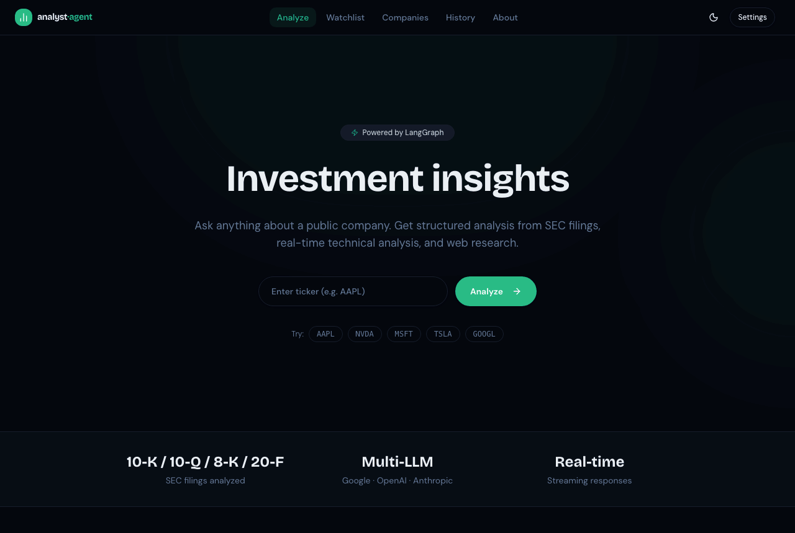
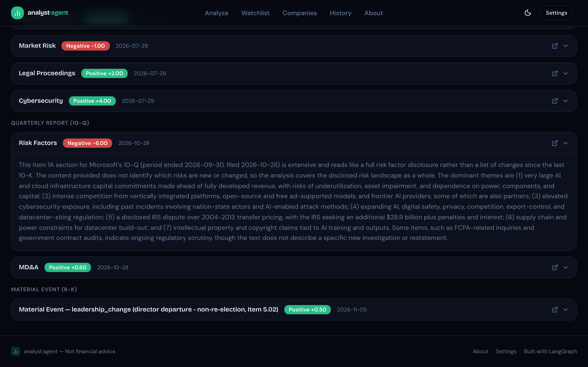
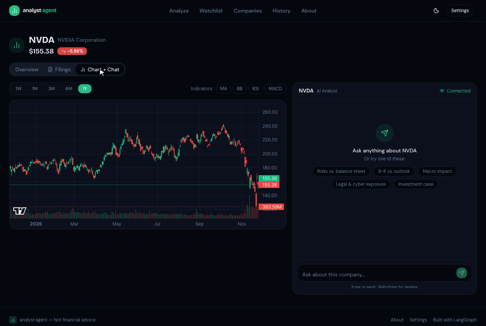
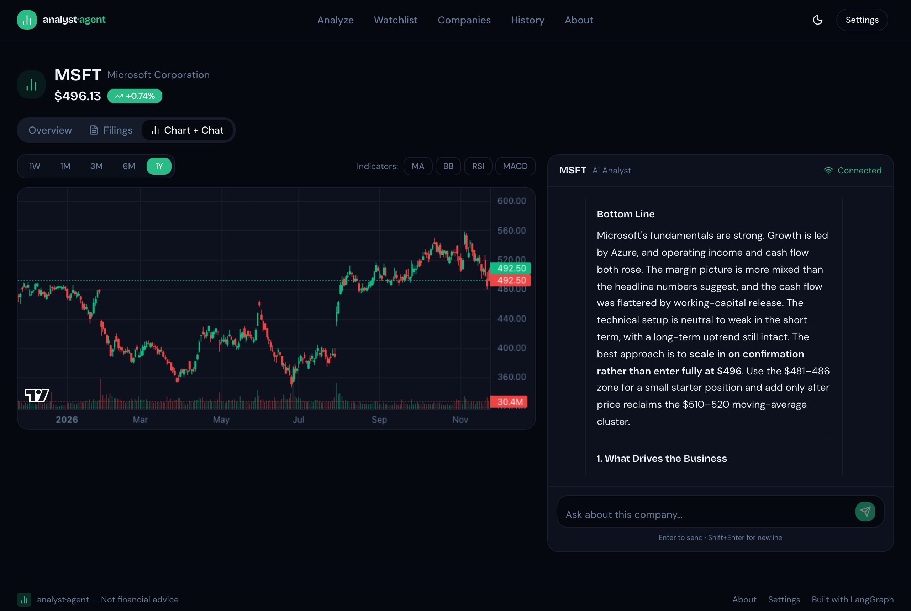
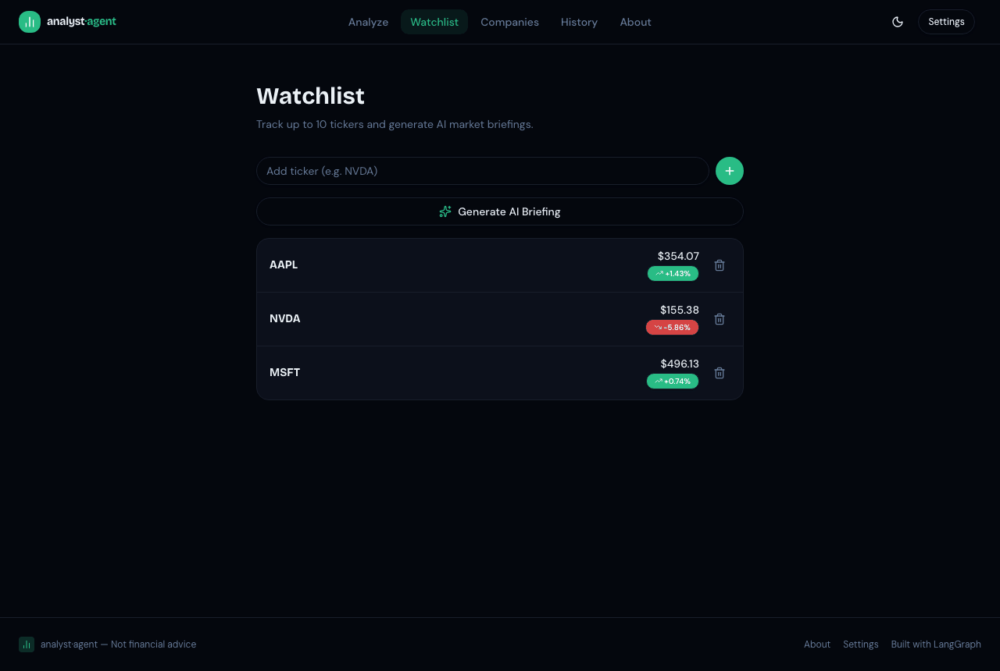
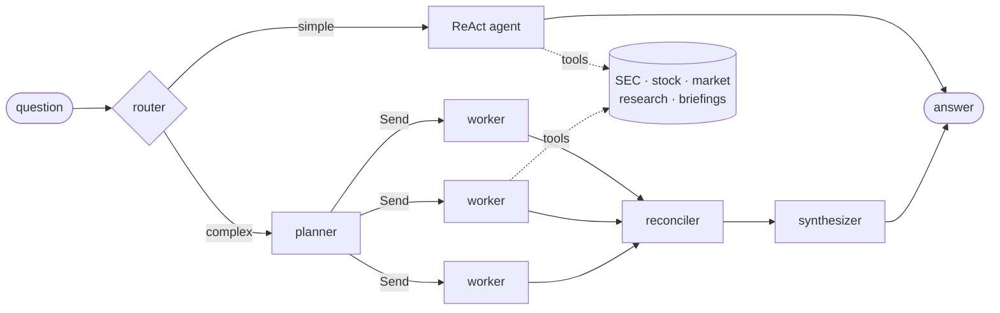

<p align="center">
  
</p>

<p align="center">
  <b>An AI analyst for any public company.</b><br>
  It reads the 10-K, 10-Q and 8-K, studies the chart and the market, and answers in plain language.<br>
  Simple questions get one tool call. Hard ones get a plan, parallel research, and a synthesis that flags contradictions.
</p>

<p align="center">
  <a href="https://analyst-agent-theta.vercel.app"><b>Live demo</b></a> ·
  <a href="#how-it-works">How it works</a> ·
  <a href="docs/DECISIONS.md">Design decisions</a> ·
  <a href="#run-it-locally">Run it locally</a>
</p>

<p align="center">
  <a href="https://github.com/jacob187/analyst-agent/actions/workflows/evals.yml"></a>
  
  
  
</p>

<p align="center">
  
</p>

---

## What it does

### Reads the filings so you don't have to

Pick a ticker and every section that matters is analyzed into a scored summary: risk factors,
MD&A, the three financial statements, business overview, market risk, legal proceedings,
cybersecurity, and the latest 8-K. Results stream in over SSE as each one finishes. Each analysis
is cached by accession number and shared by every user. When EDGAR publishes a newer filing, it is
analyzed fresh on the next visit.

<p align="center">
  
</p>

### Answers questions that span sources

*"Jensen Huang is back as CEO. How does that change NVDA's outlook against its latest earnings
release, and what is the chart saying after this week's 31% swing?"* A router sends that kind of
question to a planner. The planner splits it into independent steps, each with its own tool
arguments: the CEO-change 8-K (Item 5.02), the latest 10-Q, the news, the technicals. It runs
them in parallel, reconciles conflicting figures, and writes one answer that says which source
it trusted. Simple lookups skip the planner and go to a ReAct agent.

<p align="center">
  
</p>

### Puts the chart next to the analyst

Candlesticks with moving averages, Bollinger Bands, RSI and MACD, from one week to one year,
next to the chat. Behind the chart, the agent can call ADX, ATR stops, stochastics, volume
profile, Fibonacci levels, chart-pattern detection (head and shoulders, double tops and bottoms,
golden and death crosses, RSI divergences) and multi-timeframe analysis that flags when daily and
weekly signals disagree.

<p align="center">
  
</p>

### Briefs your watchlist

Track up to 10 tickers and generate a morning briefing. It covers the market regime, what changed
since the last briefing, and a technical outlook for each ticker with the day's headlines. Past
briefings are saved, and the agent can look them up when you chat.

<p align="center">
  
</p>

---

## How it works



- **Routing by complexity.** An LLM router classifies each question. Complex plans fan out with
  LangGraph `Send`, so independent steps run in one superstep. The reconciler is plain Python. It
  groups results by filing and lists conflicts so the synthesizer has to address them.
- **29 tools across five domains.** SEC EDGAR via edgartools (including 20-F for foreign
  filers), Yahoo Finance prices and technicals, market-wide macro data, Tavily web research, and
  briefing history. Without a Tavily key, 24 tools remain.
- **Any of three providers.** Gemini, OpenAI or Claude, chosen per request from one model
  registry (`agents/models.json`). Thinking models stream a live preview of their reasoning.
- **Built to be cheap to host.** Filing analyses are cached once and shared by everyone. The
  operator's keys are lent only to signed-in users. Each user has a daily budget weighted by model
  price, and a global cap limits total spend. Anonymous visitors can browse cached analyses
  or bring their own key. [`docs/DECISIONS.md`](docs/DECISIONS.md) explains why, with the
  benchmark numbers.
- **Keys stay in the browser.** Bring-your-own keys live in `localStorage` and are sent with each
  request. The server never stores them.

| Layer | Stack |
|---|---|
| Frontend | Next.js 16 (App Router), React 19, TypeScript, Tailwind v4, shadcn/ui, TradingView Lightweight Charts |
| Backend | FastAPI, WebSocket chat, SSE filing streams, SQLite (aiosqlite) |
| Agent | LangGraph, LangChain, Pydantic structured output, YAML prompt package |
| Data | SEC EDGAR (edgartools), Yahoo Finance (yfinance), Tavily (optional) |
| Auth & ops | Clerk (optional), OpenTelemetry/OpenInference tracing, Vercel + Railway |

---

## Run it locally

Requires **Python 3.12+**, **Node.js 20+** and **[uv](https://docs.astral.sh/uv/)**.

```bash
./install.sh   # Python + frontend deps, .env from .env.example, data dir
./start.sh     # backend on :8000, frontend on :3000
```

Add at least one LLM key, either in **Settings** (stored in your browser) or in `.env`:

```bash
GOOGLE_API_KEY=...        # or OPENAI_API_KEY / ANTHROPIC_API_KEY: one provider is enough
SEC_HEADER=Your Name you@example.com   # required by SEC EDGAR's fair-access policy
TAVILY_API_KEY=...        # optional: enables web research
```

No Clerk account is needed locally. Set `DISABLE_AUTH=true` in `.env` and
`NEXT_PUBLIC_DISABLE_AUTH=true` in `frontend/.env.local`, and the app runs as a single local user.
API docs are at `http://localhost:8000/docs`.

<details>
<summary><b>Supported models</b></summary>

The list comes from `agents/models.json`.

| Model | Provider | Context | Thinking |
|-------|----------|---------|----------|
| Gemini 3.6 Flash | Google | 1M | Yes |
| Gemini 3.1 Pro | Google | 1M | Yes |
| Gemini 3.1 Flash-Lite | Google | 1M | Yes |
| Gemini 3.8 Flash | Google | 1.05M | Yes |
| GPT-5.4 | OpenAI | 1.05M | No |
| GPT-4.1 Mini | OpenAI | 1M | No |
| GPT-5.4 Mini | OpenAI | 400K | Yes |
| GPT-5.5 | OpenAI | 1.05M | Yes |
| Claude Sonnet 4.6 | Anthropic | 1M | Yes |
| Claude Opus 4.8 | Anthropic | 1M | Yes |
| Claude Sonnet 5 | Anthropic | 1M | Yes |
| Claude Opus 5 | Anthropic | 1M | Yes |
| **Claude Haiku 5.5** (default, free trial) | Anthropic | 1M | Yes |
| Claude Sonnet 5.5 | Anthropic | 1M | Yes |

Keys: [Google AI Studio](https://aistudio.google.com/app/apikey) (free tier; Flash-Lite is the
cheapest) · [OpenAI Platform](https://platform.openai.com/api-keys) ·
[Anthropic Console](https://console.anthropic.com/settings/keys) ·
[Tavily](https://app.tavily.com/sign-in).

</details>

<details>
<summary><b>Deploying with Clerk</b></summary>

The backend verifies Clerk session tokens against Clerk's published signing keys (JWKS). Set on
the backend:

```bash
ENV=production
CLERK_SECRET_KEY=<your Clerk secret key>   # turns verification on
# The token issuer (`iss`). With the frontend proxying Clerk at /__clerk (the
# production setup in frontend/proxy.ts), it is the proxied Frontend API URL:
CLERK_ISSUER_URL=https://your-frontend.example.com/__clerk
# CLERK_JWKS_URL=...           # optional; defaults to $CLERK_ISSUER_URL/.well-known/jwks.json
```

With `ENV=production` and `CLERK_SECRET_KEY` set, the backend refuses to start without
`CLERK_ISSUER_URL`. If the JWKS can't be fetched or isn't a usable key set (wrong URL, outage),
signed-in requests whose signing key isn't already known get `503` rather than being treated as
signed out. Keys already fetched keep working through an outage.

</details>

<details>
<summary><b>Pages, routes and tables</b></summary>

| Page | |
|---|---|
| `/` | Landing: enter a ticker |
| `/company/[ticker]` | Overview, Filings and Chart + Chat tabs |
| `/companies` | Every ticker analyzed so far |
| `/watchlist` | Tracked tickers and AI briefings |
| `/history`, `/session/[id]` | Past chat sessions (signed in) |
| `/settings` | API keys and model |
| `/about` | Architecture explainer |

| Route | Transport | |
|---|---|---|
| `/ws/chat/{ticker}` | WebSocket | Chat with the agent |
| `/api/company/{ticker}/profile` | REST | Quote, metrics, technicals, patterns, regime |
| `/api/company/{ticker}/filings/stream` | SSE | Filing analyses with per-section progress |
| `/stock/{ticker}/chart` | REST | OHLCV chart data |
| `/watchlist`, `/watchlist/briefing` | REST | Watchlist CRUD and briefings |
| `/sessions`, `/models`, `/health` | REST | Sessions, model list, health |

SQLite tables: `sessions`, `messages`, `companies`, `watchlist`, `briefings`, `briefing_tickers`,
`filings_cache`, `filing_analyses`.

</details>

---

## License

[MIT](LICENSE).

Built on [edgartools](https://github.com/dgunning/edgartools), [yfinance](https://pypi.org/project/yfinance/),
[LangGraph](https://langchain-ai.github.io/langgraph/), [LangChain](https://python.langchain.com/),
[Tavily](https://tavily.com/), [Next.js](https://nextjs.org/), [shadcn/ui](https://ui.shadcn.com/)
and [TradingView Lightweight Charts](https://tradingview.github.io/lightweight-charts/).
Not financial advice.
